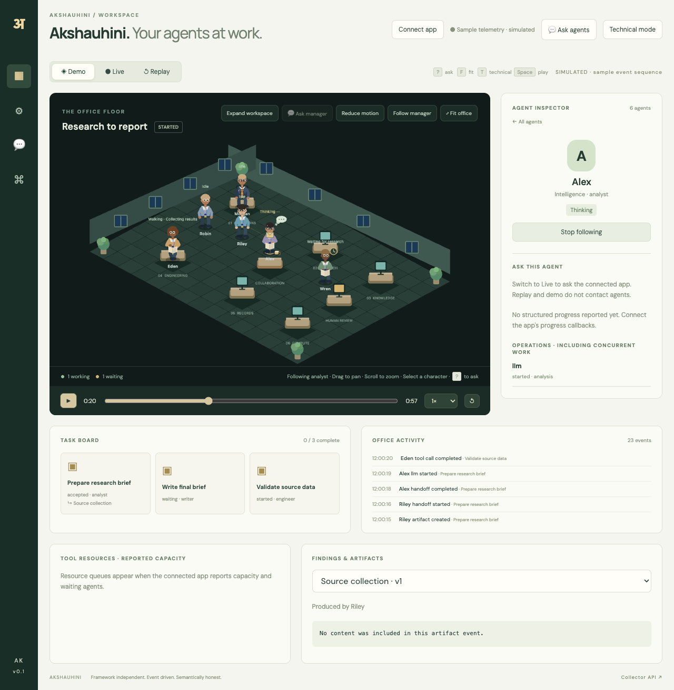

# Akshauhini

Akshauhini is a live visual monitoring tool for multi-agent applications. It renders your agents as characters in an animated office, where each movement reflects a real telemetry event: agents walk to tool stations, carry tasks, wait on dependencies, hand off work and react to errors.

It also provides a read-only view of the coding agents already installed on your machine (Claude Code, Codex CLI and Gemini CLI), built from the transcripts they save locally, with optional questions answered by a local offline LLM.



## Contents

- [Features](#features)
- [Installation](#installation)
- [Quick start](#quick-start)
- [Usage](#usage)
- [Command-line reference](#command-line-reference)
- [Connecting an application](#connecting-an-application)
- [HTTP API](#http-api)
- [OpenTelemetry input](#opentelemetry-input)
- [Local agents](#local-agents)
- [Configuration](#configuration)
- [Architecture](#architecture)
- [Security and privacy](#security-and-privacy)
- [Development](#development)
- [Examples](#examples)
- [License](#license)

## Features

- **Live office view.** Agents, tasks, tool calls, handoffs and errors are animated in real time from recorded events.
- **One collector per machine.** Every instrumented application reports to the same local collector, regardless of the directory it runs from.
- **Simple integration.** A single decorator instruments a Python agent function; any other language can post JSON events over HTTP or send OpenTelemetry spans.
- **Live and replay modes.** Follow a run as it happens, or replay stored events at 0.5×, 1×, 2× or 5× speed.
- **Agent inspector.** Inspect each agent's task queue, model, reported token usage, errors and operation durations.
- **Local agent transparency.** Review what Claude Code, Codex CLI and Gemini CLI did on this machine: timelines, files read and written, shell commands and external targets.
- **Offline analysis.** Ask questions about recorded activity using a local model served by Ollama.
- **Local by default.** The server binds to `127.0.0.1` and stores data in SQLite.

The backend is built with FastAPI and SQLite and uses the Akshauhini Event Protocol (AOEP). The frontend is built with React and PixiJS.

## Installation

Akshauhini requires Python 3.11 or later.

```bash
pip install akshauhini
```

The published package includes the prebuilt web UI, so Node.js is not required.

## Quick start

Start the office:

```bash
akshauhini
```

This starts the collector in the background and opens http://127.0.0.1:8765.

Instrument a Python agent:

```python
import akshauhini

office = akshauhini.init("my-agents", "My Agent Team")

@office.track("researcher", name="Research Agent", role="researcher")
def research_agent(topic):
    return run_your_agent(topic)

research_agent("market trends")
```

`init` starts the collector if it is not already running, so the office and your application can be launched in any order.

## Usage

A typical workflow is to start the office, connect an application, monitor its runs, review local agents, and stop the office when you are finished.

### 1. Start the office

```bash
akshauhini
```

The office starts in the background and opens http://127.0.0.1:8765 in your browser. To run it in the current terminal instead, use:

```bash
akshauhini serve --open
```

Press Ctrl+C to stop an office running in the foreground.

### 2. Connect an application

Use one of the following methods.

**Python SDK.** Add the decorator to your agent functions (see [Quick start](#quick-start)) and run your application as usual:

```bash
python your_app.py
```

**Command wrapper.** Run any program with the office attached. The program's start, completion and failure are recorded, and the office opens on the new run:

```bash
akshauhini run python your_app.py
```

**HTTP or OpenTelemetry.** Applications written in other languages can post events to `/api/events` or send spans to `/v1/traces`. See [HTTP API](#http-api) and [OpenTelemetry input](#opentelemetry-input).

### 3. Monitor a run

1. Open the office in your browser.
2. Select an application from the toolbar shortcuts or the project switcher. The **Apps** tab lists every application that has reported.
3. Choose a mode:
   - **Live** follows the selected run as events arrive.
   - **Replay** steps through stored events at 0.5×, 1×, 2× or 5× speed.
   - **Demo** shows clearly labelled sample telemetry.
4. Click an agent to open the inspector, which shows its task queue, model, token usage, errors and operation durations.
5. Click a task card to follow the agent carrying it.
6. Drag to pan and scroll to zoom.

### 4. Review local agents

Open the **Local agents** tab to see sessions from Claude Code, Codex CLI and Gemini CLI on this machine, or list them in the terminal:

```bash
akshauhini agents
```

Select a session to view its timeline, files, commands and external targets. See [Local agents](#local-agents) for details.

### 5. Ask questions with a local model (optional)

Questions are answered by a model served by [Ollama](https://ollama.com) on this machine.

1. Install Ollama, start it and download a model:

   ```bash
   ollama serve
   ollama pull <model-name>
   ```

2. Select the model from the **Settings** menu in the office, or set it before starting the office:

   ```bash
   export AKSHAUHINI_OLLAMA_MODEL=<model-name>
   ```

3. Select a session or agent and enter your question, or press `?` to ask about all sessions.

### 6. Check status and stop the office

```bash
akshauhini status   # Show whether the office is running and which applications have reported
akshauhini stop     # Stop the background office
```

## Command-line reference

### Synopsis

```
akshauhini [--port PORT] [--version] [COMMAND] [OPTIONS]
```

Running `akshauhini` without a command is equivalent to `akshauhini start`.

### Global options

Global options must be placed before the command, for example `akshauhini --port 9000 serve`.

| Option | Description |
| --- | --- |
| `--port PORT` | Port of the office (default `8765`, or the value of `AKSHAUHINI_PORT`) |
| `--version` | Print the installed version and exit |
| `-h`, `--help` | Show help and exit. Also available for each command, for example `akshauhini serve --help` |

### Commands

| Command | Description |
| --- | --- |
| [`start`](#start) | Start the office in the background if needed, and open it in the browser |
| [`serve`](#serve) | Run the office in the foreground of the current terminal |
| [`status`](#status) | Show whether the office is running and which applications have reported |
| [`stop`](#stop) | Stop the background office |
| [`run`](#run) | Run a program with the office attached |
| [`agents`](#agents) | List local agents and their recent sessions |
| [`delete-run`](#delete-run) | Permanently delete a stored run |
| [`scan`](#scan) | Mirror activity reported by a local tool into the office |

#### start

```
akshauhini start
```

Starts the office as a background process if one is not already running on the selected port, then opens it in the browser. The office keeps running until it is stopped with `akshauhini stop`.

#### serve

```
akshauhini serve [--host HOST] [--db PATH] [--app APP_ID] [--open] [--no-local-agents]
```

Runs the office in the foreground of the current terminal. Press Ctrl+C to stop it.

| Option | Description |
| --- | --- |
| `--host HOST` | Network interface to bind (default `127.0.0.1`). `0.0.0.0` exposes the unauthenticated collector to your network; local agent data remains available on loopback only |
| `--db PATH` | SQLite database for this office (default: `AKSHAUHINI_DB`, or `~/.akshauhini/akshauhini.sqlite`) |
| `--app APP_ID` | Show only runs from this application, creating a dedicated office for one project |
| `--open` | Open the office in the browser after it starts |
| `--no-local-agents` | Disable the Local agents tab |

#### status

```
akshauhini status
```

Reports whether the office is running, its version, the number of stored runs and the time of the last event for each application. Exits with code 1 if the office is not running.

#### stop

```
akshauhini stop
```

Stops a background office started by `akshauhini`, `akshauhini start`, `akshauhini.init()` or `akshauhini run`. An office started with `serve` is stopped with Ctrl+C in its terminal.

#### run

```
akshauhini run [--no-open] COMMAND [ARGS...]
```

Runs `COMMAND` with the office attached. If no office is running, one is started and remains available after the command finishes so the run can be inspected; press Ctrl+C to stop it. The command receives the `AKSHAUHINI_ENDPOINT` and `AKSHAUHINI_RUN_ID` environment variables, and its start, completion or failure is recorded. `run` exits with the exit code of `COMMAND`.

| Option | Description |
| --- | --- |
| `--no-open` | Do not open the browser. Use this in headless environments |

`run` does not inspect arbitrary Python code or patch frameworks such as LangGraph, CrewAI or AutoGen. Agent-level activity is recorded only through SDK calls, HTTP events or OpenTelemetry spans.

#### agents

```
akshauhini agents
```

Lists each supported local agent with its state (running, installed or not found), number of sessions and data directory, followed by its three most recent sessions with their tool-call and file-write counts.

#### delete-run

```
akshauhini delete-run RUN_ID [--db PATH]
```

Permanently deletes all events and questions recorded for `RUN_ID`. Stop any office that uses the database before running this command.

| Option | Description |
| --- | --- |
| `--db PATH` | SQLite database to modify (default: `AKSHAUHINI_DB`, or `~/.akshauhini/akshauhini.sqlite`) |

#### scan

```
akshauhini scan ollama [--interval SECONDS]
```

Polls a local tool's API and mirrors what it reports into the office. Ollama is currently the only supported source. The office must already be running. Run this command in a separate terminal and press Ctrl+C to stop it.

| Option | Description |
| --- | --- |
| `--interval SECONDS` | Time between polls in seconds (default `5`) |

### Examples

```bash
# Open the office on a different port
akshauhini --port 9000

# Run a dedicated office for one project with its own database
akshauhini serve --db ./office.sqlite --app my-app-id --open

# Run a script without opening the browser
akshauhini run --no-open python your_app.py

# Delete a run from the default database
akshauhini stop
akshauhini delete-run <run-id>
```

## Connecting an application

The complete [connection guide](https://github.com/abhineet-pandey/Akshauhini/blob/main/docs/CONNECTING_APPS.md) covers Python and HTTP integration, dynamic agent registration, progress updates, question handlers and Ollama setup. The UI also includes a **Connect app** guide.

### Decorator

`Office.track` is the simplest integration. It supports regular and `async` functions, preserves return values and exceptions, and automatically records agent registration, task lifecycle, duration, success and failure.

```python
from akshauhini import Office

office = Office(app_id="my-agents", app_name="My Agent Team")

@office.track("researcher", name="Research Agent", role="researcher")
def research_agent(topic):
    return run_your_agent(topic)

result = research_agent("market trends")
```

Within a tracked function, use:

- `office.operation(...)` to time tool calls and other operations.
- `office.progress(...)` to report completed work, waiting dependencies, blockers, next steps and work-unit counts. When progress is unknown, no percentage is shown.
- `office.artifact(...)` to record results and artifact metadata.

### Explicit events

For full control, register agents and emit events directly:

```python
from akshauhini import Office

with Office() as office:
    office.agent("researcher", "Riley", role="researcher", department="Research")
    office.emit("task.created", "researcher", "task-1", title="Find references")
    office.emit("task.accepted", "researcher", "task-1")
    with office.operation("task", "researcher", "task-1"):
        with office.operation("tool.call", "researcher", "task-1", tool="web_search") as metrics:
            results = your_search_function()
            metrics["result_count"] = len(results)
        office.emit("artifact.created", "researcher", "task-1", name="References")
```

`Office.operation` records a correlation ID, the elapsed time in milliseconds and any failure, then re-raises application exceptions. Connection failures to the collector produce warnings by default; pass `Office(strict=True)` to raise instead.

### Dynamic agents and questions

- Register the application with `Office(app_id="my-app", app_name="My App")` and its agents with `office.agent(...)`. Each run has its own roster; agents can join, update their metadata and leave at any time.
- Use `with office.answer_questions({agent_id: callback}): ...` to answer questions sent from the inspector. Each question is delivered to the matching agent's callback, and structured replies update its displayed progress.
- Optional summaries from a local LLM (Ollama) explain recorded telemetry without changing runtime state. No model is selected unless configured, and no fallback provider is used.

> **Note:** Events are stored exactly as supplied, without redaction. Do not include secrets or prompt contents in event data.

## HTTP API

Applications in any language can send events by posting a JSON array of 1 to 1000 events to `/api/events`:

```json
[{
  "version": "1.0",
  "event_id": "unique-event-1",
  "run_id": "run-42",
  "type": "tool.call.started",
  "timestamp": "2026-09-06T12:00:00Z",
  "agent_id": "researcher",
  "task_id": "task-1",
  "operation_id": "search-1",
  "data": {"tool": "web_search", "title": "Find references"}
}]
```

Use the same `operation_id` for the matching completion or failure event. Submitting an identical event twice has no effect; reusing an `event_id` with different contents returns `409 Conflict` and rolls back the whole batch. Producers should keep timestamps and IDs stable when retrying.

| Endpoint | Description |
| --- | --- |
| `POST /api/events` | Submit a batch of AOEP events |
| `GET /api/health` | Health status and protocol version |
| `GET /api/runs` | The latest 200 runs with event counts |
| `GET /api/runs/{run_id}/events?after=0&limit=1000` | Cursor-paginated events (maximum `limit` 5000) |
| `WS /api/live/{run_id}?after=0` | Catch-up from storage followed by live batches (150 ms polling) |
| `POST /v1/traces` | OTLP/HTTP JSON span input |
| `GET /docs` | Interactive API documentation |

The machine-readable protocol schema is available at [docs/aoep.schema.json](https://github.com/abhineet-pandey/Akshauhini/blob/main/docs/aoep.schema.json).

## OpenTelemetry input

Send OTLP/HTTP **JSON** to `/v1/traces`. Resource or span attributes must include the following:

| Attribute | Description |
| --- | --- |
| `akshauhini.agent.id` | Agent identifier (required) |
| `akshauhini.operation` | One of `llm`, `tool.call`, `task` or `review` |
| `akshauhini.run.id` | Run identifier; defaults to the trace ID |
| `akshauhini.task.id` | Task identifier (required for task spans) |
| `tool.name` | Tool name, used to choose the destination station |
| `gen_ai.request.model` | Model name shown in the inspector |
| `gen_ai.usage.input_tokens`, `gen_ai.usage.output_tokens` | Reported token counts |

Each completed span is converted into a pair of AOEP start and end events with the original timestamps and duration. A failed span produces a failure event. A review span produces only `review.started`, because the end of a span does not indicate approval; emit explicit approval or rejection events instead. Spans without these attributes are ignored.

Limitations: OTLP protobuf and gRPC are not supported, and automatic framework instrumentation is not provided. Because spans are exported only when they complete, in-progress operations are not visible; use SDK start events for live visibility.

## Local agents

The **Local agents** tab (and the `akshauhini agents` command) shows the coding agents on this machine and what they did, based on the transcript files those agents already save.

Sessions are displayed on the same office floor as connected applications. Each recent session appears as a character, grouped by agent as a department, with its project folder as its role. Every movement corresponds to a transcript entry: shell commands and edits go to engineering, file reads and searches to the archive, and web access to research, while model turns take place at the desk. Each prompt appears as a request. Inactive sessions return to the lobby and resume when their transcript is updated.

Selecting a character shows the full session timeline, files read and written, commands, external targets, token usage and models. The **Sessions & data** view provides the same details for every session.

| Agent | Source |
| --- | --- |
| Claude Code | `~/.claude/projects/*/*.jsonl` (or `$CLAUDE_CONFIG_DIR`) |
| Codex CLI | `~/.codex/sessions/**/rollout-*.jsonl` (or `$CODEX_HOME`) |
| Gemini CLI | `~/.gemini/tmp/*/chats/*.json` |
| Ollama | Live `/api/ps`: models currently loaded in memory (Ollama keeps no chat history) |
| Antigravity | Presence only; conversations are stored in a binary format that is not read |

Every view identifies the file its data came from.

### Asking questions

You can ask a question about a single session, a single agent or all agents (press `?`). Answers are generated by a local model served by Ollama, using only a digest of the relevant transcripts. Each answer lists its sources and the exact text provided to the model. Questions and answers are stored per session in your browser.

## Configuration

| Setting | Description |
| --- | --- |
| `AKSHAUHINI_HOME` | Data directory (default `~/.akshauhini`) |
| `AKSHAUHINI_DB` | Path to the SQLite database (default `~/.akshauhini/akshauhini.sqlite`) |
| `AKSHAUHINI_LOCAL_AGENTS=0` | Disable the Local agents feature (same as `serve --no-local-agents`) |
| `AKSHAUHINI_ALLOW_REMOTE_LLM=1` | Allow cloud-tagged Ollama models and non-loopback Ollama URLs |
| `AKSHAUHINI_PORT` or `--port` | Collector port (default `8765`) |
| `AKSHAUHINI_OLLAMA_MODEL` | Ollama model used for questions and summaries |
| `AKSHAUHINI_OLLAMA_URL` | Ollama server URL (default `http://127.0.0.1:11434`) |
| `serve --host` | Bind address (default `127.0.0.1`) |

To continue using a database from an earlier version, set `AKSHAUHINI_DB` to the path of your existing `./akshauhini.sqlite`.

### Applications and projects

By default, a single office serves the whole machine. The **Apps** tab shows how many applications have reported and how many are currently active. Applications that reported within the last 15 seconds appear as shortcuts in the toolbar, and the project switcher groups runs by `app_id`.

Each project's office shows only its own agents and the stations they use. A station (research, archive, records, engineering, compute, human review or meeting) appears the first time an event sends an agent there, and the operations desk appears while an agent with the manager role is present.

To isolate a project completely, give it its own database and scope:

```bash
akshauhini --port 8765 serve --db /path/to/project/office.sqlite --app my-app-id
```

A scoped office lists only runs for that `app_id` and follows the newest run; disable **Follow latest run** to keep an older run selected. An unscoped office can be filtered in the browser with `?app=my-app-id`.

Stop the office before running `delete-run` against its database. SQLite on a network file system is not safe for concurrent writers.

## Architecture

```
AOEP events → SQLite collector → state projector → behaviour engine
            → presentation scheduler → character controller → A* navigation → PixiJS
```

- **Runtime state is authoritative.** The state projector determines task state; animations never advance it.
- **Priority handling.** Errors, human decisions and cancellations interrupt the current animation immediately. Short successful operations may be displayed for up to 450 ms longer than they took, while the inspector shows the reported metrics.
- **Progress.** Progress remains indeterminate unless a `task.progress` event reports a measured `data.progress` value between 0 and 1.

### Station mapping

Tools are mapped to stations by whole words in the tool name, in the following order of precedence:

| Station | Keywords |
| --- | --- |
| Archive | `rag`, `vector`, `retriev*`, `embed*`, `document` |
| Records | `sql`, `postgres`, `database` |
| Engineering | `code`, `python`, `bash`, `git` |
| Research | `web`, `search`, `browse` |
| Compute | Any other tool |

For example, `vector_search` maps to the archive. A producer can set the station explicitly with `data.station`.

### Interactions

- `message.sent` or `handoff.started` with `data.target_agent_id` moves the agent to the target worker.
- Messages with three or more `data.participants` take place in the meeting area.
- `human.requested` moves the agent to human review. This is for display only and does not provide an approval mechanism.
- Teams of any size are supported; workers beyond the first five are placed in an open-plan area that extends the floor.

## Security and privacy

These protections are provided as is, without warranty; see [License](#license).

- The server binds to loopback by default. It has no authentication or tenant isolation and is not intended for exposure to untrusted networks.
- Local agent transcripts are read-only. Akshauhini never modifies or uploads them; excerpts are shown only in your local browser.
- Local agent endpoints accept only requests that originate from loopback **and** carry a loopback `Host` header, which prevents DNS rebinding. This applies even when the server is started with `--host 0.0.0.0`.
- Questions are refused for cloud-tagged Ollama models (`*-cloud`) and non-loopback Ollama URLs unless `AKSHAUHINI_ALLOW_REMOTE_LLM=1` is set.
- The web UI loads fonts from Google Fonts when online. This is the only request the office makes outside the local machine; without a connection it falls back to system fonts.

Known limitations and remaining work are tracked in [IMPLEMENTATION_LOG.md](https://github.com/abhineet-pandey/Akshauhini/blob/main/IMPLEMENTATION_LOG.md).

## Development

Building from source requires Python 3.11 or later and Node.js 20.19 or later.

```bash
python3 -m venv .venv
source .venv/bin/activate          # Windows PowerShell: .venv\Scripts\Activate.ps1
pip install -e '.[dev]'
cd web && npm ci && npm run build && cd ..
akshauhini serve --open
```

For frontend development, run `npm run dev` in the `web` directory alongside the collector. Vite proxies `/api` and WebSocket traffic to port 8765.

### Testing

```bash
pytest -q
cd web
npm test
npm run test:e2e
```

Browser tests require Chrome. Set `CHROME_PATH` if it is not installed at the default macOS location. The tests start a local collector automatically.

### Packaging

```bash
cd web && npm run package-ui && cd ..
python -m build
python scripts/check_dist.py dist
twine check --strict dist/*
```

`npm run package-ui` copies the built UI into `akshauhini/static` so the wheel can serve it without Node.js; run it again after any UI change. `scripts/check_dist.py` fails if a wheel is missing the UI. Releases are built and published by `.github/workflows/publish.yml` when a `v*` tag is pushed; see [docs/RELEASING.md](https://github.com/abhineet-pandey/Akshauhini/blob/main/docs/RELEASING.md).

## Examples

**Connected application**

```bash
akshauhini run python examples/connected_app.py --directory . --seconds 90
```

**Research team**

```bash
akshauhini run python examples/research_team.py
```

**Request Studio**

[Request Studio](https://github.com/abhineet-pandey/Akshauhini/blob/main/sample_projects/request_studio/README.md) is a standalone demo application. Run it in a second terminal:

```bash
.venv/bin/python sample_projects/request_studio/run.py
```

Open http://127.0.0.1:8766, enter a request, its requirements and optional source documents, then follow the run in Akshauhini. The manager agent can answer follow-up questions or route them to a specialist, with source citations. The saved report and the office artifact contain identical output. Ollama chat and embedding models can be configured from the Settings menu and enabled in the demo form.

## License

Akshauhini is released under the [Apache License 2.0](https://www.apache.org/licenses/LICENSE-2.0) and is free for personal, academic and commercial use. See [LICENSE](https://github.com/abhineet-pandey/Akshauhini/blob/main/LICENSE) and [NOTICE](https://github.com/abhineet-pandey/Akshauhini/blob/main/NOTICE).

- You may use, modify and redistribute it for any purpose.
- Redistributions must include the `LICENSE` and `NOTICE` files and state any changes made.
- Contributions are accepted under the same license.

If you use Akshauhini in published research, please cite this repository.

The web UI bundles third-party open-source components (React, PixiJS and their dependencies, and Lucide icons), each under its own permissive license; see [THIRD_PARTY_NOTICES.md](https://github.com/abhineet-pandey/Akshauhini/blob/main/akshauhini/THIRD_PARTY_NOTICES.md). The DM Sans, DM Mono, Manrope and Press Start 2P fonts are served by Google Fonts under the SIL Open Font License.
